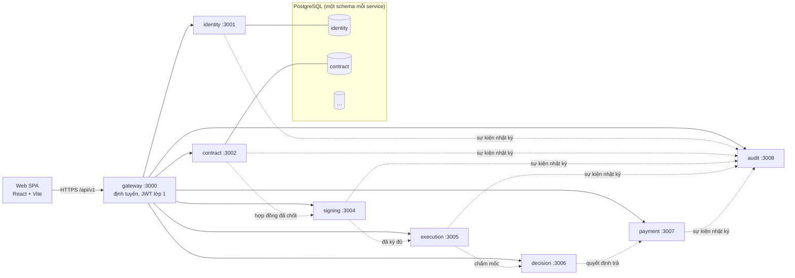
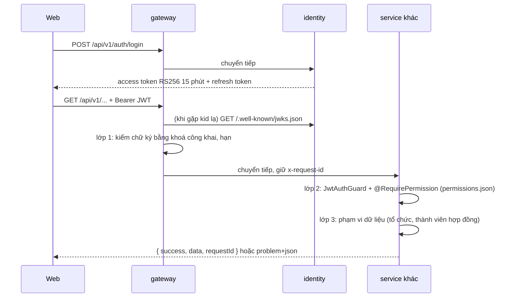
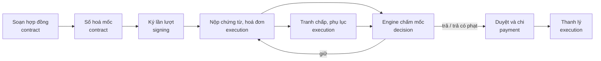

# Hệ thống trên một trang

Đọc tệp này trước khi đọc mã: các service, ai gọi ai, token đi thế nào, dữ liệu nằm đâu. Phạm vi,
quy tắc, API và saga: `docs/PHAN_TICH_THIET_KE.md`. Chi tiết
một service ở `service/SERVICE.md` của repo service đó; chassis ở `packages/nest-common/MODULES.md`.

**Luật cập nhật**: thêm service, đổi cổng hoặc schema, thêm một lời gọi giữa hai service, đổi luồng
token → sửa tệp này trong cùng commit/PR (bảng mục 1, sơ đồ mục 2–4).

## 1. Các service

| Service | Repo GitHub / thư mục | Cổng | Schema | Chủ | Sở hữu dữ liệu | Trạng thái |
| --- | --- | --- | --- | --- | --- | --- |
| gateway | repo cha, nhánh `main`, `gateway/` | 3000 | — | TV1 | — (chỉ định tuyến, kiểm JWT lớp 1) | **chạy được**, 5 test (`gateway/README.md`) |
| identity | `smart-contract-services-identity` | 3001 | `identity` | TV1 | organizations, users, settings, refresh-tokens, one-time-tokens, mail-outbox | **chạy được**, 34 test, 18 endpoint |
| contract | `smart-contract-services-contract` | 3002 | `contract` | TV2 | contract-drafts, contract-templates, milestone-templates, rule-versions, extraction-proposals | khung chạy được (repo, CI, compose, gateway); chưa có nghiệp vụ |
| signing | `smart-contract-services-signing` | 3004 | `signing` | TV3 | documents, signing, signing-requests, signing-profiles, attachments | khung chạy được (repo, CI, compose, gateway); chưa có nghiệp vụ |
| execution | `smart-contract-services-execution` | 3005 | `execution` | TV4 | parties, contracts, milestones, events, status-history, acceptance-requests, amendments, exceptions, notes | khung chạy được (repo, CI, compose, gateway); chưa có nghiệp vụ |
| decision (engine thay được; hiện Python) | `smart-contract-services-decision` | 3006 | `decision` | TV5 | evaluations, engine-runs, payment-rules | khung Python chạy được; chưa có engine |
| payment | `smart-contract-services-payment` | 3007 | `payment` | TV5 | payments | khung chạy được (repo, CI, compose, gateway); chưa có nghiệp vụ |
| audit | `smart-contract-services-audit` | 3008 | `audit` | TV6 | audit (tập trung), anchor-jobs, notifications | khung chạy được (repo, CI, compose, gateway); chưa có nghiệp vụ |

Mỗi service: một ứng dụng NestJS (decision: Python), một Dockerfile, **một database riêng** với
tài khoản riêng (`infra/postgres-init.sql`, không kết nối chéo được). **Không
service nào đọc schema của service khác**; cần dữ liệu thì gọi API của nó qua gateway.

## 2. Toàn cảnh



Nét liền: đường đi của request. Nét đứt: lời gọi hoặc sự kiện giữa các service (dự kiến, chốt khi
viết hợp đồng API của từng service; khi chốt thì sửa sơ đồ này).

## 3. Token và kiểm quyền ba lớp



Chỉ identity giữ khoá riêng; gateway và service khác **không gọi identity** để kiểm token, chỉ kiểm
chữ ký bằng khoá công khai lấy từ JWKS (`JwtAuthGuard` trong chassis). Gọi giữa service dùng
`ServiceClient` (timeout, thử lại, 503/504; `MODULES.md`).
Riêng identity kiểm thêm tài khoản còn hoạt động và `tokenVersion` (thu hồi khi đổi mật khẩu,
đăng xuất, khoá).

## 4. Luồng nghiệp vụ chính



Trạng thái hợp đồng: `DRAFT → IN_REVIEW → AGREED → SIGNING → ACTIVE → … → thanh lý`; chuyển sai
trả 409 `INVALID_TRANSITION`. Luật, số tiền, mã trạng thái: `../codecash/docs/NGHIEP_VU.md` (mục 14
là từ điển trạng thái); câu chuyện đầu–cuối: `../codecash/docs/33_LUONG_NGHIEP_VU_DAU_CUOI.md`.

## 5. Quy ước chung mọi service

| Việc | Quy ước | Ở đâu |
| --- | --- | --- |
| Khởi động | `bootstrapService({ module, name, port })`, tiền tố `/api/v1`, Swagger `/api/docs`, `/health` | chassis `bootstrap.ts` |
| Kết quả | `{ success, data, requestId }` | `TransformInterceptor` |
| Lỗi | RFC 9457 problem+json, `code` UPPER_SNAKE_CASE, `errors[]` theo trường | `problem.ts` |
| Đầu vào | DTO + `ValidationPipe` toàn cục; CRUD chung kiểm theo `resources.json` | `dto/`, `BaseService` |
| Danh sách | `/resources/:r` có lọc theo toán tử, cột, facets, nhập, xuất | `MODULES.md` |
| Lần vết | `x-request-id` từ gateway đi qua mọi service | `bootstrap.ts` |
| Nhật ký | ghi qua `Repository.mutate/transact` (chuỗi băm) | `repository.ts` |
| Dữ liệu | một schema mỗi service (`PG_SCHEMA`), `STORAGE_DRIVER=file` khi test | `postgres-store.ts` |

## 6. Chạy cả hệ

Các repo để cạnh nhau (`CLAUDE.md` mục 1), trong `btl-backend` (nhánh `main`):

```bash
docker compose up --build --wait        # Postgres, RabbitMQ, 7 service, gateway; chỉ gateway mở cổng 3000 (RabbitMQ UI: 15672)
npx newman run postman/smart-contract.postman_collection.json -e postman/local.postman_environment.json
```

CI của repo cha (job `stack`) làm đúng hai lệnh này trên mỗi lần push. Thêm service: thêm vào
`compose.yaml`, tiền tố của nó vào `gateway/routes.json`, request vào `postman/`, sửa bảng mục 1.
