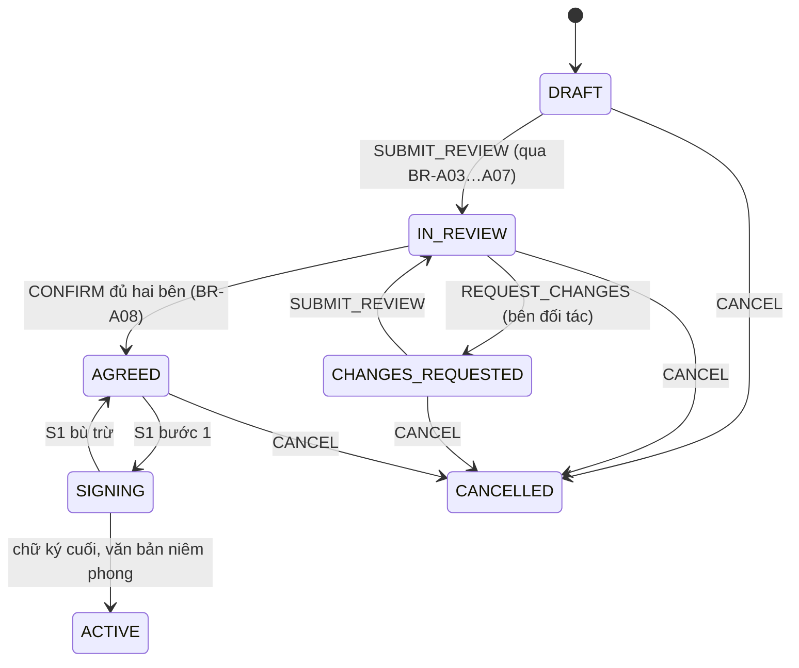
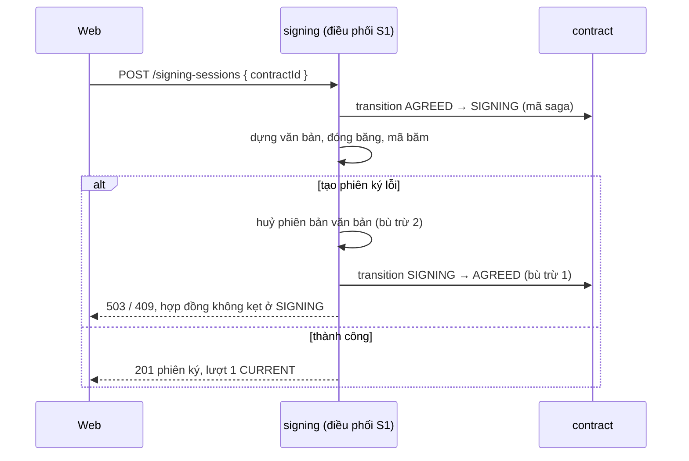

# Phân tích và thiết kế

Tài liệu chốt cho cả nhóm: làm gì (phạm vi, tính năng, quy tắc), từng service đưa ra API nào, các
service nói chuyện với nhau ra sao, và mỗi yêu cầu của hai môn nằm ở đâu. Toàn cảnh kỹ thuật:
`docs/HE_THONG.md`. Sản phẩm là gì, khác bài dự thi ở đâu, sửa gì cho sát thực tế (mã D, P, N, T dùng
bên dưới): `docs/DINH_VI_SAN_PHAM.md`. Ai làm, ngày nào: `docs/KICH_BAN_VIBE_CODE.md`. Nghiệp vụ gốc, luôn thắng khi
mâu thuẫn: `../codecash/docs/NGHIEP_VU.md`.

Vì sao từng lựa chọn (đồng bộ hay hàng đợi, gateway, RS256, saga, CI…) và các luồng chính đi qua
đâu: `docs/LUAN_CU_KIEN_TRUC.md`.

**Luật cập nhật**: chủ service sửa mục của service mình (§3, §6, §7, §8) khi hợp đồng API, quy tắc
hay luồng đổi; `service/openapi.yaml` là bản chi tiết và phải khớp bảng ở đây.

## 1. Bài toán và phạm vi

Sản phẩm: **Smart Contract Workflow (SCW)**, nền tảng SaaS B2B cho bên mua và nhà cung cấp. Hợp đồng trả tiền theo nhiều đợt (mốc). Muốn chi một đợt phải kiểm đủ chứng từ, đủ người duyệt,
không tranh chấp, có trễ hạn hay không. Hệ thống viết các điều kiện đó thành **luật**: các bên soạn
và ký hợp đồng, nộp chứng từ, phê duyệt, mở tranh chấp; sau mỗi thao tác **engine chấm lại** mốc ra
RELEASE / HOLD / PENALTY / REJECT, kèm số tiền và **vì sao**; lệnh chi đi qua ngân hàng mô phỏng;
mọi thao tác ghi vào nhật ký chuỗi băm.

| Mức | Nội dung |
| --- | --- |
| **Must** | Đăng ký tổ chức, đăng nhập, mời thành viên (xong); soạn hợp đồng **trong ứng dụng** từ mẫu, có mốc, kiểm tổng 100% và trần phạt theo loại hợp đồng (P1); rà soát hai chiều; ký tuần tự bằng chữ ký điện tử mô phỏng (P4) và niêm phong văn bản; hoá đơn đủ trường hoá đơn điện tử (P6); tiền tính bằng đồng (D3); dữ liệu mẫu nạp sẵn cho demo (D1); hợp đồng ký xong tự sang phần thực hiện; nộp chứng từ, phê duyệt, tranh chấp; engine ra quyết định có vết; lệnh chi qua ngân hàng mô phỏng; nhật ký chuỗi băm và kiểm toàn vẹn |
| **Should** | Màn "Kiểm chứng bộ luật" trên dữ liệu mẫu (D2); mã hợp đồng theo tổ chức (D5); ngoại lệ hai người duyệt; chạy thử phê duyệt; thông báo (email mô phỏng); tổng quan có biểu đồ; vi/en |
| **Could** | Nhắc việc quá hạn theo lịch; xuất PDF biên nhận quyết định; mã VietQR trên lệnh chi |
| **Won't** | Chữ ký số thật qua CA, giữ hay chuyển tiền thật (P7), kết nối hoá đơn điện tử của cơ quan thuế, AI đọc hợp đồng (T1) |

## 2. Người dùng và vai trò

| Vai trò | Thuộc | Làm gì | Ma trận quyền |
| --- | --- | --- | --- |
| Khách (chưa đăng nhập) | — | Xác minh văn bản bằng mã băm, xem lời mời | route công khai |
| `ORG_ADMIN` | công ty | Quản trị tài khoản công ty, mời thành viên (chỉ vai trò được cấp) | `packages/contracts/permissions.json` |
| `CONTRACT_OWNER` | bên mua | Soạn hợp đồng, mốc; phê duyệt nghiệm thu; mở tranh chấp; đề xuất ngoại lệ | |
| `LEGAL_REVIEWER` | bên mua | Rà soát điều khoản | |
| `FINANCE_APPROVER`, `SECONDARY_APPROVER` | bên mua | Phê duyệt tài chính, duyệt lệnh chi | |
| `SUPPLIER` | nhà cung cấp | Rà soát, ký, nộp chứng từ và hoá đơn | |
| `ADMIN_AUDITOR` | vận hành | Kiểm soát viên: duyệt ngoại lệ (SoD-2) | |
| `AUDITOR` | vận hành | Chỉ đọc, kiểm chuỗi băm | |
| `SYSTEM_ADMIN` | vận hành | Cấu hình, tài khoản nền tảng | |

Bảo vệ ba lớp (LT-06): gateway kiểm token (lớp 1) → guard trong service kiểm token và quyền
(`@RequirePermission`) (lớp 2) → service kiểm phạm vi dữ liệu: thành viên hợp đồng, đúng bên, đúng tổ
chức (lớp 3). Web ẩn nút theo quyền nhưng không bao giờ là lớp kiểm duy nhất.

## 3. Service, dữ liệu, tính năng

6 service nghiệp vụ cộng identity và gateway. Mỗi service một repo, một Dockerfile,
một database riêng.

| Service | Chủ | Sở hữu dữ liệu | Tính năng (Must trước) | Trạng thái |
| --- | --- | --- | --- | --- |
| identity | TV1 | organizations, users, settings, refresh-tokens, one-time-tokens, mail-outbox | Đăng ký, đăng nhập, refresh, đổi và quên mật khẩu, mời thành viên, JWKS, khoá tài khoản | **xong** |
| contract | TV2 | contract-templates, contract-drafts, milestone-templates, rule-versions, extraction-proposals, comments | Mẫu hợp đồng; soạn bản nháp từ mẫu; số hoá mốc (BR-A03…A07); thành viên và nhiệm vụ; rà soát hai chiều, bình luận, xác nhận (BR-A08); máy trạng thái (BR-A02); hồ sơ pháp lý theo loại hợp đồng (P1); lãi chậm trả (P2); mẫu từ 4 quy trình có sẵn (N2) | chưa |
| signing | TV3 | documents (phiên bản, mã băm, niêm phong), signing (phiên ký, lượt), signing-requests, signing-profiles, attachments | Dựng văn bản từ điều khoản, đóng băng, mã băm; phiên ký và lượt ký đúng thứ tự (BR-A09, A10); ký điện tử mô phỏng (mức `SIMULATED`, P4) qua nhà cung cấp mô phỏng; niêm phong; xác minh công khai; tải tệp chứng từ (BR-A11); **xác minh** chữ ký số trên văn bản và chứng từ (chứng thư còn hiệu lực, chưa thu hồi, dấu thời gian), tra cứu hoá đơn điện tử (mô phỏng), lưu bằng chứng dài hạn (BR-A12); điều phối S1, phát `contract.activated` (S2) | chưa |
| execution | TV4 | parties, contracts (bản thực hiện), milestones, events (chứng từ), status-history, acceptance-requests, amendments, exceptions, notes | Nhập hợp đồng đã ký (S2, idempotent); nạp dữ liệu mẫu (D1); mốc và "việc còn lại" có người chịu trách nhiệm; nộp chứng từ và hoá đơn đủ trường (BR-B03, B08, B11, B13); phê duyệt theo vai trò (BR-B05); tranh chấp (BR-B09); ngoại lệ hai người (BR-B12); phụ lục dời hạn; thanh lý; gọi decision, PENDING_EVALUATION (S3) | chưa |
| decision | TV5 | evaluations, engine-runs, payment-rules (bộ luật có phiên bản) | Engine sau một hợp đồng API (hiện là engine Python bọc FastAPI, thay được): chấm một mốc ra RELEASE/HOLD/PENALTY/REJECT kèm vết luật (BR-B01…B07); chạy thử; một bộ luật đã công bố cho mỗi hợp đồng, có phiên bản (N1); kiểm chứng bộ luật trên dữ liệu mẫu (D2); chạy bóng engine mới; chấm lại theo lô khi công bố luật | chưa |
| payment | TV5 | payments (lệnh chi), saga-log | Lập lệnh chi khi quyết định trả tiền (BR-B10), duyệt; **không giữ tiền**, chỉ gửi lệnh sang ngân hàng của bên mua (P7): gửi ngân hàng mô phỏng có `Idempotency-Key`, PENDING và đối soát, gửi lại (S4) | chưa |
| audit | TV6 | audit (tập trung, chuỗi băm), anchor-jobs, notifications, processed-messages | Nhận sự kiện của mọi service (idempotent, DLQ); chuỗi băm và `GET /audit/verify`; neo Merkle; thông báo trong ứng dụng và email mô phỏng | chưa |
| gateway | TV1 | — | Điểm vào duy nhất, kiểm JWT lớp 1, giới hạn, CORS, request id, 503/504 | **xong** |

Ranh giới dữ liệu đã chốt (lập luận ở `docs/LUAN_CU_KIEN_TRUC.md` §2): identity là nguồn của tổ
chức, `parties` ở execution chỉ là bản sao chỉ đọc theo mã; execution giữ **ảnh chụp bất biến** của
hợp đồng đã ký (gói v1), contract giữ bản đang soạn; decision **không gọi ngược** execution mà nhận
trọn gói dữ kiện của mốc trong request. **Tiền** mọi nơi là chuỗi số nguyên đồng (`…Vnd`, D3); cách
làm tròn tiền phạt chờ quyết định D4.

**Vì sao chia như vậy** (bằng chứng đầy đủ: `LUAN_CU_KIEN_TRUC.md` §2): soạn thảo, ký, thực hiện, quyết định, chi tiền, kiểm toán có dữ liệu sở
hữu, tần suất đổi và rủi ro khác nhau (giá trị pháp lý của chữ ký khác an toàn dòng tiền; engine là
một engine thay được nằm sau hợp đồng API; phần ký và xác minh gọi nhiều hệ ngoài nhất). **Vì sao không nhỏ hơn**: tách phê duyệt khỏi chứng từ, hay
tài liệu khỏi ký, làm mỗi lần chấm mốc hoặc mỗi lượt ký phải gọi chéo mà không giảm rủi ro nào.

## 4. Quy tắc nghiệp vụ (MS-R1)

Mỗi quy tắc có mã, service thực thi và mã lỗi; test của service phải có một ca vi phạm. Nguồn:
`../codecash/docs/NGHIEP_VU.md` (BR-01…BR-20) và luật engine.

| Mã | Quy tắc | Service | Vi phạm trả |
| --- | --- | --- | --- |
| BR-A01 | Chỉ thành viên hợp đồng xem được; bên đối tác chỉ thấy sau khi gửi rà soát | contract | 404 (không lộ tồn tại) |
| BR-A02 | Chuyển trạng thái theo bảng §5.1; chuyển sai bị từ chối | contract | 409 `INVALID_TRANSITION` |
| BR-A03 | Tổng tỷ lệ các mốc 100%; tổng giá trị mốc bằng giá trị hợp đồng (thập phân, không số thực) | contract | 422 `PAYMENT_SPLIT_INVALID` |
| BR-A04 | Hạn mốc trong thời hạn hợp đồng, không giảm theo thứ tự | contract | 422 `MILESTONE_DATES_INVALID` |
| BR-A05 | Trần phạt không vượt mức luật theo loại hợp đồng (thương mại 8%) | contract | 422 `PENALTY_CAP_EXCEEDS_LEGAL_LIMIT` |
| BR-A06 | Mỗi loại chứng từ bắt buộc thuộc đúng một bên; mỗi mốc có người thực hiện | contract | 422 `EXECUTOR_MISSING` |
| BR-A07 | Một người không vừa thực hiện vừa phê duyệt cùng mốc (SoD) | contract | 422 `SOD_CONFLICT` |
| BR-A08 | Khoá điều khoản khi cả hai bên xác nhận; sửa sau xác nhận thì xác nhận bị huỷ | contract | 409 `CONFIRMATION_RESET` |
| BR-A09 | Ký đúng lượt, mỗi lượt một lần, đúng người được gán | signing | 409 `NOT_YOUR_TURN`, 409 `ALREADY_SIGNED`, 403 `NOT_ASSIGNED_SIGNER` |
| BR-A10 | Chữ ký gắn mã băm văn bản; văn bản đổi sau chữ ký đầu thì dừng | signing | 409 `DOCUMENT_CHANGED` |
| BR-A11 | Tệp chỉ PDF, DOCX, PNG, JPEG theo nội dung, tối đa 20 MB | signing | 415 `UNSUPPORTED_TYPE`, 413 `FILE_TOO_LARGE` |
| BR-A12 | Chứng từ mang chữ ký số hoặc là hoá đơn điện tử chỉ được tính khi xác minh đạt: chứng thư còn hiệu lực và chưa bị thu hồi tại thời điểm ký, nội dung khớp chữ ký, hoá đơn tra cứu được | signing (xác minh), execution (không tính khi chưa đạt) | chứng từ `VERIFYING` / `REJECTED` kèm lý do `SIGNATURE_INVALID`, `CERTIFICATE_REVOKED`, `INVOICE_NOT_FOUND` |
| BR-B01 | Có tranh chấp mở thì HOLD | decision | quyết định HOLD `OPEN_DISPUTE` |
| BR-B02 | Có từ chối hợp lệ thì REJECT | decision | quyết định REJECT |
| BR-B03 | Chứng từ của bên không có thẩm quyền không được tính | execution | 403 `NOT_AUTHORIZED_PARTY` |
| BR-B04 | Thiếu chứng từ bắt buộc thì HOLD | decision | quyết định HOLD |
| BR-B05 | Đếm phê duyệt theo vai trò, mỗi vai trò một lần | execution | 409 `ALREADY_APPROVED_BY_ROLE`, 403 `ROLE_NOT_REQUIRED` |
| BR-B06 | Trễ sau ân hạn thì phạt `MIN(ngày × tỷ lệ × P, trần × P)`, làm tròn HALF_UP 0,01 | decision | quyết định PENALTY |
| BR-B07 | Đủ điều kiện thì RELEASE; không khớp luật nào thì HOLD | decision | quyết định RELEASE/HOLD |
| BR-B08 | Chứng từ trùng không tính hai lần | execution | 409 `DUPLICATE_EVIDENCE` |
| BR-B09 | Một tranh chấp mở mỗi mốc; chỉ bên mua đóng | execution | 409 `DISPUTE_ALREADY_OPEN`, 403 |
| BR-B10 | Lệnh chi chỉ khi quyết định trả tiền, một lần mỗi mốc, chỉ phê duyệt tài chính bên mua duyệt | payment | 409 `DECISION_NOT_PAYABLE`, 409 `ORDER_EXISTS`, 403 |
| BR-B11 | Mốc đã chi hoặc bị từ chối bị khoá | execution | 409 `MILESTONE_LOCKED` |
| BR-B12 | Ngoại lệ do chủ hợp đồng đề xuất, kiểm soát viên duyệt, không tự duyệt | execution | 409 `SELF_APPROVAL_FORBIDDEN` |
| BR-B13 | Hoá đơn có đủ ký hiệu, số, ngày, MST hai bên, tiền trước thuế, thuế suất, tiền thuế; tổng khớp giá trị mốc (P6) | execution | 422 `INVOICE_INVALID`, 422 `INVOICE_AMOUNT_MISMATCH` |
| BR-I01 | Tự đăng ký chỉ tạo công ty mới + `ORG_ADMIN`; quản trị công ty chỉ mời vai trò được cấp | identity | 403 `ROLE_NOT_ASSIGNABLE` (**xong**) |
| BR-I02 | 5 lần sai mật khẩu trong 15 phút khoá tài khoản 15 phút | identity | 429 `ACCOUNT_TEMPORARILY_LOCKED` (**xong**) |

## 5. Trạng thái

### 5.1. Hợp đồng (contract)



Bảng chuyển viết một lần thành union type + `canTransition(state, action)`, dùng ở web (ẩn nút) và
service (409). Mã trạng thái đúng từ điển `NGHIEP_VU.md` mục 14.

### 5.2. Mốc (execution)

`WAITING_EVIDENCE` → `WAITING_APPROVAL` → `ELIGIBLE_FOR_PAYMENT` | `PAID_WITH_PENALTY` | `ON_HOLD` |
`REJECTED`; thêm `PENDING_EVALUATION` (decision chưa trả lời, S3), `PAYMENT_REQUESTED` (S4 bước 1),
`COMPLETED`. Trạng thái chỉ đổi theo quyết định của decision hoặc theo saga, không bao giờ do web.

## 6. API từng service (bản nháp, qua gateway `/api/v1`)

Tiền tố đường dẫn của mỗi service không trùng nhau (gateway định tuyến theo tiền tố dài nhất, `gateway/routes.json`): execution dùng `/executions` cho hợp đồng đang thực hiện, `/contracts` là của contract.
Chi tiết trong `service/openapi.yaml` của từng repo; mỗi service ≥ 4 endpoint, ≥ 1 lỗi nghiệp vụ
4xx có `code` (MS-R3). Lỗi theo RFC 9457. Danh sách, lọc, nhập, xuất của bảng dữ liệu đơn giản dùng
CRUD chung `/resources/<collection>` của chassis (`MODULES.md`); bảng dưới là nghiệp vụ riêng.

| Service | Endpoint | Thành công | Lỗi nghiệp vụ |
| --- | --- | --- | --- |
| identity | `POST /auth/register`, `/login`, `/refresh`, `/logout`, `/password`, `/forgot-password`, `/reset-password`, `/invitations`, `/invitations/accept`; `GET /auth/me`, `/.well-known/jwks.json` | 200/201/202 | xem `openapi.yaml` của identity |
| contract | `GET /templates` | 200 | |
| contract | `POST /contracts` (từ mẫu) | 201 | 422 BR-A05 |
| contract | `GET /contracts?status=&search=&page=`, `GET /contracts/{id}` | 200 | 404 BR-A01 |
| contract | `PATCH /contracts/{id}` (kèm `version`) | 200 | 409 `CONTRACT_LOCKED`, 409 `VERSION_CONFLICT` |
| contract | `PUT /contracts/{id}/milestones` | 200 | 422 BR-A03, A04, A05 |
| contract | `PUT /contracts/{id}/members` | 200 | 422 BR-A06, A07 |
| contract | `POST /contracts/{id}/transitions` `{ action }` | 200 | 409 BR-A02, BR-A08 |
| contract | `POST /contracts/{id}/comments` | 201 | 409 khi đã khoá |
| signing | `POST /documents` (multipart), `GET /documents/{id}`, `GET /documents/{id}/content` | 201/200 | 415, 413 BR-A11; 409 BR-A10 |
| signing | `GET /public/verify?hash=` (khách) | 200 `{ status: VALID \| UNKNOWN }` | |
| signing | `POST /verifications` (chứng từ hoặc văn bản, bất đồng bộ), `GET /verifications/{id}` | 202 `VERIFYING`, 200 kết quả kèm bằng chứng | 415, 422 `NOTHING_TO_VERIFY` |
| signing | `POST /signing-sessions` (S1) | 201 | 409 `CONTRACT_NOT_AGREED` |
| signing | `GET /signing-sessions/{id}` | 200 | 404 |
| signing | `POST /signing-sessions/{id}/steps/{n}/sign` (`Idempotency-Key`) | 200 `SIGNED` / 202 `PENDING_PROVIDER` | 409, 403 BR-A09 |
| execution | `POST /contract-imports` (gói hợp đồng, S2) | 201 | 409 `ALREADY_IMPORTED`, 422 `PACKAGE_INVALID` |
| execution | `GET /executions`, `GET /executions/{contractId}` (hợp đồng đang thực hiện kèm mốc), `GET /milestones/{id}` (kèm `pending`) | 200 | 404 |
| execution | `POST /milestones/{id}/evidence` | 201 | 403 BR-B03, 409 BR-B08, BR-B11 |
| execution | `POST /milestones/{id}/approvals`, `/rejections` | 201 | 409, 403 BR-B05 |
| execution | `POST /milestones/{id}/disputes`, `POST /disputes/{id}/resolution` | 201/200 | 409, 403 BR-B09 |
| execution | `POST /milestones/{id}/exceptions`, `POST /exceptions/{id}/decision` | 201/200 | 409 BR-B12 |
| execution | `GET /tasks` (việc còn lại của người gọi) | 200 | |
| decision | `POST /evaluations` (một mốc, `dryRun`) | 200 | 422 `INVALID_FACTS` |
| decision | `GET /decisions/{milestoneId}`, `GET /decisions/{milestoneId}/trace` | 200 | 404 |
| decision | `GET /rule-sets`, `POST /rule-sets`, `POST /rule-sets/{id}/publish` | 200/201 | 422 `RULE_SET_INVALID`, 409 `RULE_VERSION_UNSAFE` |
| payment | `POST /payment-orders` (`Idempotency-Key`) | 201; trùng khoá 200 lệnh cũ | 409, 403 BR-B10 |
| payment | `POST /payment-orders/{id}/approval` | 200 `SENT` / 202 `PENDING` | 409 `ALREADY_APPROVED`, 403 |
| payment | `GET /payment-orders?status=`, `GET /payment-orders/{id}`, `POST /payment-orders/{id}/retry` | 200 | 404, 409 `ALREADY_SETTLED` |
| audit | `GET /audit-entries`, `GET /audit/verify`, `GET/POST /audit/anchors` | 200/201 | 403 |
| audit | `GET /notifications`, `PATCH /notifications/{id}/read`, `GET /dlq`, `POST /dlq/{id}/replay` | 200 | 404, 403 |
| mọi service | `GET /health` (có kiểm database) | 200 / 503 | |

## 7. Lời gọi giữa service và sự kiện (MS-R5)

Gọi đồng bộ bằng `ServiceClient` của chassis (timeout, chỉ thử lại lỗi hạ tầng với method idempotent
hoặc có `Idempotency-Key`, 4xx trả nguyên, 502/503/504). Không service nào đọc database của service
khác.

| Lời gọi | Timeout | Thử lại | Khi thất bại |
| --- | --- | --- | --- |
| gateway → service | 10 s | không | 503 / 504 cho web |
| signing → contract (đổi trạng thái) | 2 s | 2, cùng mã saga | bù trừ S1 |
| signing → nhà cung cấp ký mô phỏng | 3 s | 2, cùng `Idempotency-Key`; circuit breaker (phụ thuộc ngoài) | lượt `PENDING_PROVIDER`, đối soát |
| execution → decision (chấm mốc; gửi kèm gói dữ kiện của mốc) | 2 s | 2 (hàm thuần) | `PENDING_EVALUATION`, job chấm lại mỗi 10 s (S3) |
| execution → signing (yêu cầu xác minh chứng từ) | qua hàng đợi | theo lịch, lùi dần | chứng từ ở `VERIFYING`, chưa tính vào điều kiện chi |
| signing → dịch vụ kiểm thu hồi, dấu thời gian, tra cứu hoá đơn (mô phỏng) | 3 s | 2; circuit breaker; kết quả kiểm thu hồi được giữ ngắn hạn | thử lại theo lịch; quá hạn thì `FAILED` có lý do, người nộp gửi lại |
| payment → decision (xác nhận quyết định) | 2 s | 2 (đọc) | bù trừ S4 |
| payment → ngân hàng mô phỏng | 3 s | 2, cùng mã lệnh; circuit breaker + bulkhead 5 | `PENDING` + đối soát (S4) |
| outbox → hàng đợi | — | mỗi 2 s tới khi gửi được | giữ trong outbox |
| consumer (audit, execution) | — | 3 lần, lùi dần | DLQ, xem và đẩy lại ở audit |

| Sự kiện | Phát | Nhận | Khoá idempotent |
| --- | --- | --- | --- |
| `contract.review_requested`, `contract.agreed` | contract | audit (thông báo) | `eventId` |
| `signing.step_ready` | signing | audit (thông báo) | `eventId` |
| `contract.activated` (kèm gói hợp đồng v1) | signing | execution (S2), audit | `contract.id` |
| `evidence.submitted`, `approval.recorded`, `dispute.opened`, `dispute.resolved` | execution | audit | `eventId` |
| `verification.requested` | execution | signing | `evidenceId` |
| `evidence.verified`, `evidence.rejected` | signing | execution (chấm lại), audit | `verificationId` |
| `rule_set.published` | decision | execution (đẩy chấm lại theo lô) | `ruleSetId + version` |
| `decision.made` | decision | execution, audit | `evaluationId` |
| `payment.order_created`, `payment.settled`, `payment.failed` | payment | execution, audit | `orderId` |

Hàng đợi (RabbitMQ) dùng ở năm chỗ, hai nhóm: sự kiện **nhiều bên nhận hoặc bên phát không được phụ
thuộc bên nhận** (`contract.activated`, `payment.settled`, mục nhật ký về audit, thông báo) và **việc
chậm hoặc nhiều** (yêu cầu xác minh chứng từ, chấm lại theo lô khi công bố luật). Luồng tiền và luồng
chấm mốc thường ngày là đồng bộ có PENDING. Thiếu thời gian thì outbox + gửi HTTP có thử lại thay cho broker
(`LUAN_CU_KIEN_TRUC.md` §6).

Gói hợp đồng v1 (`contract.activated`): hợp đồng (mã, loại, giá trị dạng chuỗi thập phân, thời hạn,
chính sách duyệt), hai bên, các mốc (thứ tự, loại, hạn, %, giá trị, chứng từ bắt buộc, vai trò duyệt,
ân hạn, tỷ lệ và trần phạt), thành viên và nhiệm vụ, mã băm văn bản đã niêm phong, các chữ ký, bộ
luật áp dụng. Tên trường mốc trùng cột `milestones.csv` của dữ liệu mẫu để engine dùng ngay; số tiền trong gói tính bằng đồng.

## 8. Luồng nhiều bước (MS-R6)

| Mã | Luồng | Điều phối | Xử lý lỗi | Chủ |
| --- | --- | --- | --- | --- |
| S1 | Mở phiên ký: contract `AGREED → SIGNING` → signing đóng băng văn bản → tạo phiên và lượt | signing | **bù trừ ngược**: huỷ phiên, huỷ phiên bản văn bản, hợp đồng về `AGREED` | TV3 |
| S2 | Kích hoạt: chữ ký cuối → niêm phong → contract `ACTIVE` → phát `contract.activated` → execution nhập | sự kiện | outbox gửi lại tới khi được; execution nhập idempotent; gói sai mã băm vào DLQ | TV3 phát, TV4 nhận |
| S3 | Nộp chứng từ khi decision sập | execution | **PENDING**: lưu chứng từ (201), mốc `PENDING_EVALUATION`, job chấm lại khi decision sống lại; không chứng từ nào mất, không quyết định nào đoán | TV4 |
| S4 | Lập và chi lệnh: mốc `PAYMENT_REQUESTED` → xác nhận quyết định → lệnh `APPROVED` → gửi ngân hàng | payment | **bù trừ** bước 1–3 khi lỗi rõ ràng; **PENDING** + đối soát theo `Idempotency-Key` khi hết thời gian | TV5 |



```mermaid
sequenceDiagram
  participant W as Web (phê duyệt tài chính)
  participant P as payment (điều phối S4)
  participant E as execution
  participant D as decision
  participant B as ngân hàng mô phỏng
  W->>P: POST /payment-orders { milestoneId } + Idempotency-Key
  P->>E: mốc → PAYMENT_REQUESTED
  P->>D: quyết định hiện hành còn trả tiền? (mã băm quyết định)
  P->>P: lệnh APPROVED
  W->>P: POST /payment-orders/{id}/approval
  P->>B: gửi lệnh, Idempotency-Key = mã lệnh, timeout 3 s
  alt hết thời gian
    P-->>W: 202 PENDING; job đối soát hỏi ngân hàng theo khoá
  else lỗi rõ ràng
    P->>E: trả mốc về trạng thái trước (bù trừ)
    P-->>W: lệnh FAILED, cho gửi lại
  else đã chi
    P-->>W: 200 SENT; phát payment.settled → execution, audit
  end
```

Mọi bước và bù trừ ghi `saga-log` (mã saga, bước, trạng thái); bù trừ idempotent; mọi trạng thái
PENDING có job đối soát.

## 9. Thí nghiệm lỗi (MS-R8, cần ≥ 2)

Chạy trước (tắt cơ chế bằng `RESILIENCE_ENABLED=false`) và sau, cùng tải k6 20 người dùng ảo 60 giây.

| Mã | Kịch bản | Chủ | Đo |
| --- | --- | --- | --- |
| F1 | Tắt decision khi đang nộp chứng từ (S3) | TV4 | tỷ lệ request thành công, p95, thời gian để mọi mốc `PENDING_EVALUATION` được chấm |
| F2 | Ngân hàng chậm 5 s, lỗi 30% (S4) | TV5 | số lệnh trùng, tỷ lệ lỗi, thời gian circuit breaker mở, số lệnh PENDING được đối soát |
| F3 | Lỗi giữa S1 | TV3 | số hợp đồng kẹt ở `SIGNING` (trước) so với 0 (sau), thời gian bù trừ |
| F4 | Tắt execution khi hợp đồng vừa ký (S2), kèm một message hỏng | TV6 | số hợp đồng mất (trước) so với 0 (sau), message hỏng ở DLQ không chặn hàng đợi |

## 10. Yêu cầu hai môn → nơi đáp ứng

### 10.1. Kiến trúc Microservices

| Mã | Đáp ứng ở | Chủ | Trạng thái |
| --- | --- | --- | --- |
| MS-R1 ≥ 5 quy tắc | §4 (27 quy tắc), test vi phạm từng service | TV2 gom | 2/27 có test |
| MS-R2 chia service, database riêng | §3, `compose.yaml`, `infra/postgres-init.sql` | TV1 | **xong**: 6 repo + 6 database, chạy chung trong compose |
| MS-R3 ≥ 4 endpoint REST, lỗi 4xx, OpenAPI | §6, `service/openapi.yaml` từng repo | chủ service | identity **xong** |
| MS-R4 gateway duy nhất | `gateway/` | TV1 | **xong** |
| MS-R5 timeout, retry, 503/504, health, `*_URL` | `ServiceClient`, `/health`, `.env.example`, §7 | TV1 (thư viện), chủ service dùng | **xong** thư viện (timeout, thử lại, circuit breaker, bulkhead) |
| MS-R6 saga, PENDING | §8 S1–S4 | TV3, TV4, TV5 | chưa |
| MS-R7 Docker, `docker compose up` | `compose.yaml`, job CI `stack` | TV1 | **xong**: 7 service + gateway + RabbitMQ |
| MS-R8 Postman ≥ 10, ≥ 2 thí nghiệm lỗi | `postman/` (25 request identity), §9 | mỗi người ≥ 5 request; TV6 thí nghiệm | identity **xong** |
| MS-B1 hàng đợi, consumer idempotent, DLQ | audit consumer, outbox | TV1 (hạ tầng), TV6 (consumer của audit) | hạ tầng **xong** (outbox, RabbitMQ, `consume()` idempotent, DLQ); consumer audit chưa |
| MS-B2 JWT ở gateway | RS256 + JWKS | TV1 | **xong** |
| MS-B3 circuit breaker / bulkhead | payment → ngân hàng, signing → nhà cung cấp | TV5, TV3 | thư viện **xong** (`ServiceClient`), áp vào lời gọi chưa |
| MS-B4 CI test tự động | CI mỗi repo + job `stack` chạy compose và Newman | TV1 | **xong** |

### 10.2. Lập trình Web nâng cao

| Mã | Đáp ứng ở | Chủ | Trạng thái |
| --- | --- | --- | --- |
| LT-01 TypeScript strict, generic, utility type, type guard | mọi repo `strict`; kiểu dùng chung `@codecash/contracts` | mọi người | khung **xong** |
| LT-02 feature folder, ≥ 2 hook generic, 1 pattern | `src/features/*`; `useListQuery<T>`; Render Props `<Can>`, HOC `withPermission`; Compound `<MilestoneBuilder>` (TV2), `<DecisionTrace>` (TV5) | TV2, TV4, TV5 | một phần |
| LT-03 Redux Toolkit + Context | phiên đăng nhập trong `createSlice`; theme, ngôn ngữ qua Context | TV1 | **xong** |
| LT-04 lazy route, memo có lý do, ≥ 200 dòng ảo hoá/phân trang, Profiler/Lighthouse | lazy mọi route; phân trang máy chủ; bảng mốc ảo hoá (TV4) | TV4, TV6 | một phần |
| LT-05 ≥ 15 test, độ phủ ≥ 50% | Vitest + RTL + MSW, cổng độ phủ trong `pnpm check` | mọi người ≥ 5 | 54 test, 57% |
| LT-06 đăng ký/đăng nhập, ≥ 2 vai trò RBAC, nhiều lớp | identity + gateway + guard + phạm vi dữ liệu | TV1 (+ chủ service lớp 3) | **xong** phần định danh |
| LT-07 DTO + ValidationPipe, lỗi thống nhất, Module–Controller–Service, Interceptor, Filter | chassis (`MODULES.md` mục LT-07) | TV1 | **xong** |
| LT-08 lazy route, 404, title động | `router.tsx`, `NotFoundPage`, `useDocumentTitle` | TV1 | **xong** |
| LT-09 commit theo tính năng, `.env.example`, không secret, 390 px | quy trình nhánh, CI | mọi người | đang làm |
| LT-T2 ≥ 3 vai trò (kể cả khách), ≥ 5 thực thể | §2, §3 | — | **xong** |
| LT-T3 ≥ 1 nghiệp vụ khó ngoài CRUD | máy trạng thái hợp đồng, ký tuần tự, engine, chống chi trùng | TV2, TV3, TV5 | chưa |

## 11. Quyết định kiến trúc cần ghi (ADR, đưa vào báo cáo)

| ADR | Quyết định |
| --- | --- |
| 001 | Mỗi service một repo, phần nền kéo từ repo cha (`docs/KIEN_TRUC_REPO.md`) |
| 002 | Chia 6 service nghiệp vụ như §3; vì sao không ít hơn, không nhiều hơn |
| 003 | Token RS256 + JWKS, access 15 phút + refresh xoay vòng trong cookie HttpOnly |
| 004 | Gateway tự viết (TypeScript, `node:http`) thay vì Kong/Traefik: giải thích được từng chính sách |
| 005 | Saga điều phối tập trung + outbox, thay vì choreography |
| 006 | Engine quyết định nằm sau một hợp đồng API, thay được (hiện là engine Python); thay engine thì chạy bóng và so bộ kiểm hồi quy trước khi bật |
| 010 | Ký và xác minh là một service: mọi lời gọi tới nhà cung cấp ký, kiểm thu hồi, dấu thời gian, tra cứu hoá đơn đi qua đây; xác minh chứng từ bất đồng bộ |
| 007 | Tiền là chuỗi số nguyên đồng, không dùng số thực; dữ liệu mẫu (đơn vị triệu) quy đổi lúc nạp (D3, D4) |
| 008 | Bộ dữ liệu của bài toán gốc chỉ là dữ liệu mẫu và bộ kiểm hồi quy, không phải đầu vào của sản phẩm (D1, D2) |
| 009 | Không giữ tiền: hệ thống tạo và gửi lệnh chi, ngân hàng của bên mua chuyển tiền (P7) |
