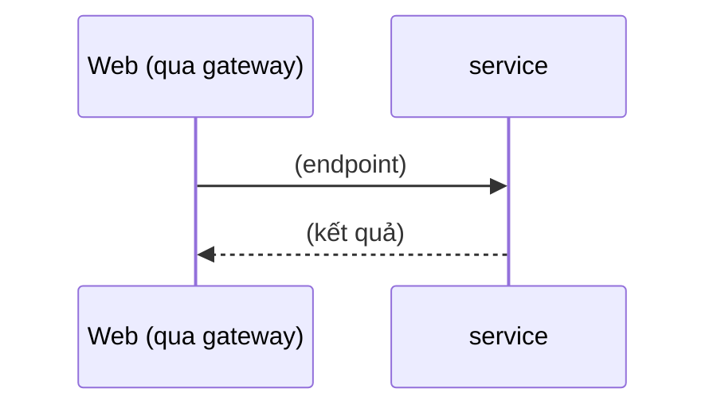

# Service `signing`

Thẻ của service: AI và người đọc tệp này trước khi sửa mã. Chủ service cập nhật nó **trong cùng
commit** với mã theo luật ở mục 4 của `CLAUDE.md` (CI `pnpm check:docs` nhắc khi quên). Mẫu này nằm
trong khuôn; `scripts/new-service.sh` điền tên.

## Thông tin

| | |
| --- | --- |
| Chủ | TV3 (điền tên, tài khoản GitHub) |
| Cổng mặc định | 3004 (`bootstrapService({ port: 3004 })`; trong compose là 3000) |
| Database | `signing` (tài khoản `signing`, `infra/postgres-init.sql`), `PG_SCHEMA=signing` |
| Gọi qua gateway | `/api/v1/documents`, `/api/v1/signing-sessions`, `/api/v1/verifications`, `/api/v1/public/verify` (`gateway/routes.json` của repo cha) |
| Thẻ nhiệm vụ | `docs/nhiem-vu/TV3.md` |

## Sơ đồ mã

Mỗi tệp trong `service/src` một dòng: làm gì. AI đọc bảng này thay vì mở từng tệp.

| Tệp | Làm gì |
| --- | --- |
| `main.ts` | Khởi động: `bootstrapService({ module, name, port })` |

## Sơ đồ luồng

Luồng chính của service (Mermaid). Sửa khi đổi luồng, thêm lời gọi sang service khác hoặc sự kiện.

## Dữ liệu sở hữu

Chỉ service này ghi các bảng (collection) dưới đây; service khác hỏi qua API hoặc sự kiện.

| Collection | Ý nghĩa | Khai báo trong `packages/contracts/resources.json`? |
| --- | --- | --- |
| documents | Văn bản và tệp: phiên bản, mã băm, niêm phong | chưa |
| signing | Phiên ký và lượt ký | chưa |
| signing-requests | Yêu cầu gửi nhà cung cấp ký, trạng thái PENDING | chưa |
| verifications | Kết quả xác minh chữ ký, chứng từ, kèm bằng chứng | chưa |
| saga-log | Bước và bù trừ của S1 | chưa |

Bản dự kiến theo `docs/PHAN_TICH_THIET_KE.md` §3; chủ service sửa khi chốt.

## Endpoint

Chi tiết ở `service/openapi.yaml`. Mỗi endpoint có ít nhất một lỗi nghiệp vụ 4xx kèm mã.

| Phương thức, đường dẫn | Quyền | Lỗi nghiệp vụ |
| --- | --- | --- |
| `POST /documents, GET /documents/{id}, GET /documents/{id}/content` | đã đăng nhập, theo quyền xem | 415, 413 (BR-A11); 409 `DOCUMENT_CHANGED` |
| `POST /signing-sessions` | người soạn | 409 `CONTRACT_NOT_AGREED` |
| `GET /signing-sessions/{id}` | thành viên | 404 |
| `POST /signing-sessions/{id}/steps/{n}/sign` | người được gán | 409 `NOT_YOUR_TURN`, `ALREADY_SIGNED`; 403 `NOT_ASSIGNED_SIGNER` |
| `POST /verifications, GET /verifications/{id}` | service execution, thành viên | 422 `NOTHING_TO_VERIFY` |
| `GET /public/verify?hash=` | công khai |  |

Bản dự kiến theo `docs/PHAN_TICH_THIET_KE.md` §6 (chưa làm); `openapi.yaml` là bản chi tiết.

## Sự kiện

| Phát | Nhận |
| --- | --- |

## Nguồn CodeCash

Tệp trong `../codecash` chuyển vào service này (xem `docs/DOI_CHIEU_CODECASH.md`), và đã chuyển chưa.

| Tệp cũ | Sang | Trạng thái |
| --- | --- | --- |

## Rà soát nghiệp vụ

Chỗ mã cũ lệch, thiếu so với `../codecash/docs/NGHIEP_VU.md`, và đã xử lý thế nào.

## Cải tiến so với CodeCash

Những gì làm khác hoặc tốt hơn bản cũ, và vì sao (dùng cho báo cáo).
